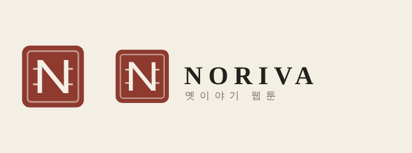

# 06. 브랜드와 톤앤매너

**원칙: 플랫폼은 물러서고, 작품이 앞에 나온다.** NORIVA의 화면은 한지 위에 먹으로 쓴 것처럼 조용해야 해요. 색과 장식은 작품 표지와 그림이 가져가고, 플랫폼은 그 둘레의 여백이 돼요.

## 1. 로고

- **마크:** 낙관(서화 끝에 찍는 붉은 도장) 안에 **띠살문 창살**로 짠 N. 세로 창살 두 개를 사선 살이 잇고, 가로 띠살 네 개가 문살 느낌을 줘요. "옛이야기를 열고 들어가는 문"이라는 뜻이에요.
- **글자:** NORIVA는 명조 계열(Noto Serif KR) 대문자에 자간을 넓게. 아래에 작게 "옛이야기 웹툰".
- **파일:** `web/public/brand/mark.svg`(마크), `web/public/brand/logo.svg`(가로형), 화면에서는 `web/src/components/logo.tsx`.
- **쓰는 법:** 마크는 낙관 빨강 한 가지 색만. 작품 표지 위에 로고를 크게 올리지 않아요. 앱 아이콘은 마크만 써요.
- **하지 않을 것:** 그라데이션, 그림자, 금박, 태극·단청 문양을 통째로 가져다 쓰기. 한국적인 느낌은 재료(한지, 먹, 낙관, 창살)에서 오고, 국가 상징에서 오지 않아요.

## 2. 색

| 이름 | 밝은 화면 | 어두운 화면 | 쓰임 |
| --- | --- | --- | --- |
| 한지 `paper` | `#F6F2EA` | `#1A1917` | 바탕 |
| 종이 `paper-raised` | `#FBF9F4` | `#23211E` | 카드, 사이드바 |
| 먹 `ink` | `#24221F` | `#ECE6DA` | 본문, 기본 버튼 |
| 묽은 먹 `ink-soft` / 흐린 먹 `ink-faint` | `#5C574F` / `#8C867B` | `#B8B0A2` / `#8A8377` | 보조 글자 |
| 닥종이 결 `line` | `#DDD5C6` | `#36332E` | 구분선 |
| 낙관 빨강 `seal` | `#8E3A2F` | `#C0594A` | 로고, 화면에서 가장 중요한 동작 하나 |
| 쪽빛 `indigo` | `#2F4858` | `#8FB0C2` | 링크, 선택 |
| 송록 `pine` / 황토 `ochre` / 자주 `plum` | `#4D6A48` / `#9A6B1F` / `#7B3F4F` | 밝게 조정 | 승인 / 검토 대기 / 낡음·반려 |

- 낙관 빨강은 **한 화면에 한 번**만 (예: "승인", "새 작품 기획", 독자 앱의 "다음 화"). 여러 곳에 쓰면 도장의 의미가 사라져요.
- 상태 색은 채도를 낮춘 전통 색(송록, 황토, 자주)이라 경고처럼 튀지 않아요.
- 독자 뷰어의 어두운 화면은 "밤 먹빛"이에요. 웹툰 그림 색을 해치지 않게 순수한 검정 대신 아주 따뜻한 짙은 회색을 써요.

## 3. 글꼴

| 용도 | 글꼴 | 이유 |
| --- | --- | --- |
| 화면 글자 | Pretendard | 한국어·영어 모두 읽기 좋고 무료 상업 이용 가능 |
| 제목, 로고, 작품명 | Noto Serif KR (명조) | 책과 옛 문서의 느낌, 작품명을 조용히 격 있게 |
| 말풍선 | 작품별 웹툰용 글꼴 (04번 7장) | 플랫폼 글꼴과 분리 |

한국어는 어절 단위로 줄바꿈(`word-break: keep-all`)해요.

## 4. 화면 원칙

1. **작품 표지가 가장 크고 가장 색이 많다.** 목록과 홈에서 표지 비율(3:4)을 지키고, 표지 주변에는 장식 대신 여백.
2. **선은 얇게, 그림자는 없게.** 카드 구분은 1px 닥종이 결 선으로.
3. **모서리는 살짝만 (5~6px).** 둥글둥글한 앱 느낌보다 종이와 책의 느낌.
4. **한지 결 질감**(`.hanji`)은 빈 화면, 로그인, 표지 없는 자리에만 아주 옅게.
5. **문장은 존댓말 해요체**, 짧고 다정하게. 영어는 짧고 담백하게.
6. **애니메이션은 거의 없이.** 화면 전환은 빠르게, 연출은 웹툰 안에서만.

## 5. 이후 할 일

- 로고 글자를 외곽선(path)으로 바꾼 최종 SVG와 앱 아이콘 세트 (iOS, Android, 파비콘)
- 독자 앱 화면에 같은 토큰 적용 (2단계)
- 대표님이 로고 시안을 보고 방향을 정하면 2~3개 변형을 더 만들어 비교
